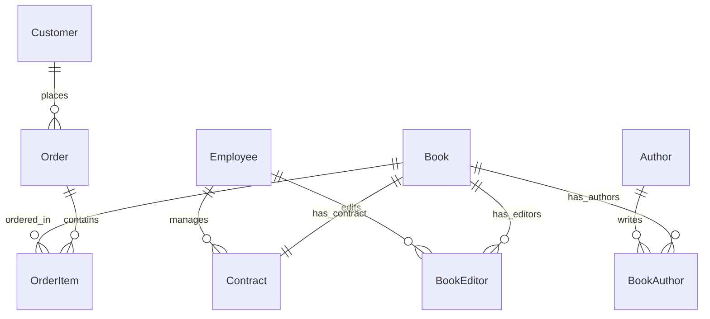

# Лабораторная работа 3: Информационная система типографии на Django REST Framework

В этой работе реализована информационная система для типографии с использованием Django REST Framework, Djoser и PostgreSQL.

## Техническое задание

**Цель:** Создать программную систему, предназначенную для информационного обслуживания редакторов, менеджеров и других сотрудников типографии.

**Требуемый функционал:**

- Данные о сотрудниках компании, книгах, авторах
- Финансовое состояние компании (контракты, заказы)
- Система контрактов с авторами
- Система редактирования книг
- Управление заказами
- Регистрация/авторизация по токенам через Djoser
- Генерация разнообразных отчётов

**Особенности предметной области:**

- Каждая книга издаётся в рамках контракта
- Книга может быть написана несколькими авторами
- Контракт подписывается одним менеджером и всеми авторами книги
- Порядок авторов на обложке влияет на размер гонорара
- Редактор может работать над несколькими книгами
- У каждой книги может быть несколько редакторов, один — ответственный
- Заказ оформляется на одного заказчика и может содержать несколько книг

## Архитектура приложения

### Модели данных

| Модель | Поля | Описание |
|--------|------|----------|
| **Employee** | `user`, `first_name`, `last_name`, `middle_name`, `email`, `role`, `position_title`, `hire_date`, `phone` | Сотрудники (менеджеры, редакторы) |
| **Author** | `first_name`, `last_name`, `middle_name`, `email`, `bio`, `birth_date`, `phone` | Авторы книг |
| **Book** | `title`, `isbn`, `pages`, `has_illustrations`, `publication_date`, `cover_price`, `description`, `genre`, `language` | Книги |
| **Contract** | `contract_number`, `book`, `manager`, `signed_date`, `status`, `advance_payment`, `total_budget`, `expiry_date`, `notes` | Контракты на издание |
| **BookAuthor** | `book`, `author`, `author_order`, `royalty_percentage` | Связь книга-автор с порядком и процентом гонорара |
| **BookEditor** | `book`, `editor`, `is_chief_editor`, `assigned_date` | Связь книга-редактор с ответственным редактором |
| **Customer** | `name`, `email`, `phone`, `address`, `company_name` | Заказчики |
| **Order** | `order_number`, `customer`, `order_date`, `total_amount`, `status` | Заказы на покупку |
| **OrderItem** | `order`, `book`, `quantity`, `unit_price`, `subtotal` | Позиции заказа |

### ER-диаграмма



## API Endpoints

### CRUD Endpoints (ViewSets)

| Endpoint | Методы | Описание |
|----------|--------|----------|
| `/api/v1/employees/` | GET, POST, PUT, PATCH, DELETE | Управление сотрудниками |
| `/api/v1/authors/` | GET, POST, PUT, PATCH, DELETE | Управление авторами |
| `/api/v1/books/` | GET, POST, PUT, PATCH, DELETE | Управление книгами |
| `/api/v1/contracts/` | GET, POST, PUT, PATCH, DELETE | Управление контрактами |
| `/api/v1/customers/` | GET, POST, PUT, PATCH, DELETE | Управление заказчиками |
| `/api/v1/orders/` | GET, POST, PUT, PATCH, DELETE | Управление заказами |
| `/api/v1/book-authors/` | GET, POST, PUT, PATCH, DELETE | Связь книга-автор |
| `/api/v1/book-editors/` | GET, POST, PUT, PATCH, DELETE | Связь книга-редактор |
| `/api/v1/order-items/` | GET, POST, PUT, PATCH, DELETE | Позиции заказов |

### Отчёты

| Endpoint | Параметры | Описание |
|----------|-----------|----------|
| `/api/v1/reports/books-by-author/` | `author_id` | Список всех изданных книг заданного автора |
| `/api/v1/reports/chief-editors/` | — | Список ответственных редакторов для всех изданий |
| `/api/v1/reports/editors-per-book/` | — | Количество редакторов каждой книги |
| `/api/v1/reports/contracts-by-month/` | `year` | Количество контрактов за каждый месяц за год |
| `/api/v1/reports/top-managers/` | `start_date`, `end_date` | Менеджеры с максимальным количеством контрактов за период |
| `/api/v1/reports/quarterly-contracts/` | `quarter`, `year` | Отчёт о контрактах за квартал с детальной информацией |

### Аутентификация (Djoser)

| Endpoint | Описание |
|----------|----------|
| `/api/auth/users/` | Регистрация пользователя |
| `/api/auth/token/login/` | Получение токена |
| `/api/auth/token/logout/` | Выход (удаление токена) |
| `/api/auth/users/me/` | Информация о текущем пользователе |

## Реализованный функционал

### Система аутентификации (Djoser)
- Регистрация пользователей
- Аутентификация по токенам
- Получение информации о текущем пользователе
- Защита API с `IsAuthenticatedOrReadOnly`

### Управление сотрудниками
- Роли: Менеджер, Редактор, Другое
- Валидация роли при назначении на контракт/книгу
- Поиск и фильтрация по роли, дате найма

### Система контрактов
- Связь один-к-одному с книгой
- Валидация: контракт подписывает только менеджер
- Валидация: аванс не превышает общий бюджет
- Статусы: Черновик, Активный, Завершен, Расторгнут

### Управление книгами
- M2M связь с авторами через промежуточную модель `BookAuthor`
- M2M связь с редакторами через промежуточную модель `BookEditor`
- Порядок авторов на обложке (`author_order`)
- Процент гонорара для каждого автора
- Только один ответственный редактор на книгу

### Система заказов
- Заказ оформляется на одного заказчика
- M2M связь с книгами через `OrderItem`
- Автоматический расчёт подытога позиции
- Статусы: Ожидает, В обработке, Завершен, Отменен

### Отчёты и аналитика
1. **Книги автора** — список всех изданных книг заданного автора
2. **Ответственные редакторы** — для всех изданий
3. **Количество редакторов** — для каждой книги
4. **Контракты по месяцам** — за истекший год
5. **Топ менеджеры** — с максимальным количеством контрактов за период
6. **Квартальный отчёт** — детальная информация по контрактам за квартал

## Технические особенности

### Сериализаторы

```python
# Базовые сериализаторы с вычисляемыми полями
class EmployeeSerializer(serializers.ModelSerializer):
    full_name = serializers.SerializerMethodField()

# Сериализаторы с валидацией бизнес-логики
class BookEditorSerializer(serializers.ModelSerializer):
    def validate_editor(self, value):
        if value.role != 'EDITOR':
            raise serializers.ValidationError(...)

    def validate(self, data):
        # Проверка единственного ответственного редактора
        ...

# Вложенные сериализаторы для детальных представлений
class BookDetailSerializer(serializers.ModelSerializer):
    authors = BookAuthorSerializer(source='book_authors', many=True)
    editors = BookEditorSerializer(source='book_editors', many=True)
```

### ViewSets с фильтрацией

```python
class BookViewSet(viewsets.ModelViewSet):
    queryset = Book.objects.prefetch_related(
        Prefetch('book_authors', queryset=BookAuthor.objects.select_related('author').order_by('author_order')),
        Prefetch('book_editors', queryset=BookEditor.objects.select_related('editor'))
    ).select_related('contract').all()

    filter_backends = [DjangoFilterBackend, filters.SearchFilter, filters.OrderingFilter]
    filterset_fields = ['has_illustrations', 'genre', 'language', 'publication_date']
    search_fields = ['title', 'isbn', 'description']
    ordering_fields = ['title', 'publication_date', 'pages', 'cover_price']
```

### Агрегационные запросы для отчётов

```python
# Контракты по месяцам с TruncMonth
contracts_by_month = Contract.objects.filter(
    signed_date__year=year
).annotate(
    month=TruncMonth('signed_date')
).values('month').annotate(
    count=Count('id')
).order_by('month')

# Менеджеры с количеством контрактов
managers_with_contracts = Employee.objects.filter(
    role='MANAGER',
    managed_contracts__signed_date__range=[start_date, end_date]
).annotate(
    contracts_count=Count('managed_contracts')
).order_by('-contracts_count')
```

### База данных
- **СУБД:** PostgreSQL
- **ORM:** Django ORM с оптимизацией запросов
- **Индексы:** на часто используемых полях (role, signed_date, status)

### Безопасность
- Token Authentication через DRF
- Djoser для управления пользователями
- Валидация на уровне моделей и сериализаторов
- CSRF защита

## Структура проекта

```
publishing_house/
├── publishing_house/          # Настройки проекта
│   ├── settings.py           # Конфигурация Django
│   ├── urls.py               # URL-роутер
│   └── wsgi.py               # WSGI конфигурация
├── publishing/               # Основное приложение
│   ├── models.py             # Модели данных (9 моделей)
│   ├── views.py              # ViewSets и API Views
│   ├── serializers.py        # Сериализаторы DRF
│   ├── admin.py              # Админ-панель
│   ├── urls.py               # URL-маршруты с Router
│   └── management/           # Команды управления
│       └── commands/
│           └── populate_db.py # Заполнение тестовыми данными
├── requirements.txt          # Зависимости
└── manage.py                 # Управляющий скрипт
```

## Установка и запуск

### 1. Установка зависимостей
```bash
pip install -r requirements.txt
```

### 2. Настройка PostgreSQL
```sql
CREATE DATABASE publishing_db;
```

### 3. Настройка переменных окружения
```bash
# .env файл
SECRET_KEY=your-secret-key
DEBUG=True
DB_NAME=publishing_db
DB_USER=postgres
DB_PASSWORD=your-password
DB_HOST=localhost
DB_PORT=5432
```

### 4. Применение миграций
```bash
python manage.py makemigrations
python manage.py migrate
```

### 5. Создание суперпользователя
```bash
python manage.py createsuperuser
```

### 6. Загрузка тестовых данных
```bash
python manage.py populate_db
```

### 7. Запуск сервера
```bash
python manage.py runserver
```

## Примеры использования API

### Регистрация и аутентификация

```bash
# Регистрация
curl -X POST http://localhost:8000/api/auth/users/ \
  -H "Content-Type: application/json" \
  -d '{"username": "testuser", "email": "test@example.com", "password": "testpass123", "re_password": "testpass123"}'

# Получение токена
curl -X POST http://localhost:8000/api/auth/token/login/ \
  -H "Content-Type: application/json" \
  -d '{"username": "testuser", "password": "testpass123"}'

# Использование токена
curl http://localhost:8000/api/v1/books/ \
  -H "Authorization: Token YOUR_TOKEN_HERE"
```

### Работа с книгами

```bash
# Список книг
curl http://localhost:8000/api/v1/books/

# Книга с деталями (авторы, редакторы, контракт)
curl http://localhost:8000/api/v1/books/1/

# Поиск книг
curl "http://localhost:8000/api/v1/books/?search=Django"

# Фильтрация
curl "http://localhost:8000/api/v1/books/?has_illustrations=true&genre=IT"
```

### Отчёты

```bash
# Книги автора
curl "http://localhost:8000/api/v1/reports/books-by-author/?author_id=1"

# Ответственные редакторы
curl http://localhost:8000/api/v1/reports/chief-editors/

# Контракты за 2024 год по месяцам
curl "http://localhost:8000/api/v1/reports/contracts-by-month/?year=2024"

# Топ менеджеры за период
curl "http://localhost:8000/api/v1/reports/top-managers/?start_date=2024-01-01&end_date=2024-12-31"

# Квартальный отчёт
curl "http://localhost:8000/api/v1/reports/quarterly-contracts/?quarter=4&year=2024"
```

## Используемые технологии

| Технология | Версия | Назначение |
|------------|--------|------------|
| Django | 5.2.9 | Web-фреймворк |
| Django REST Framework | 3.14.0 | REST API |
| Djoser | 2.3.3 | Аутентификация |
| PostgreSQL | 15+ | База данных |
| psycopg2-binary | 2.9.11 | PostgreSQL драйвер |
| django-filter | 23.5 | Фильтрация |
| drf-spectacular | 0.29.0 | OpenAPI документация |
| python-decouple | 3.8 | Конфигурация |

## Заключение

Успешно реализована информационная система типографии с полноценным REST API. Система включает:

**Основные достижения:**

- Полная реализация всех требований технического задания
- 9 связанных моделей данных с валидацией бизнес-логики
- CRUD операции для всех сущностей через ViewSets
- 6 аналитических отчётов с агрегацией данных
- Аутентификация по токенам через Djoser
- Документация API через drf-spectacular

**Технические навыки:**

- Проектирование сложных моделей данных с M2M связями
- Создание промежуточных моделей с дополнительными полями
- Реализация бизнес-валидации в моделях и сериализаторах
- Оптимизация запросов с `select_related` и `prefetch_related`
- Агрегационные запросы с `annotate`, `Count`, `TruncMonth`
- Работа с Django REST Framework и Djoser

